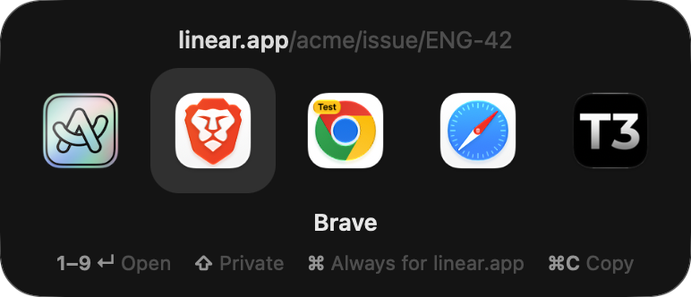
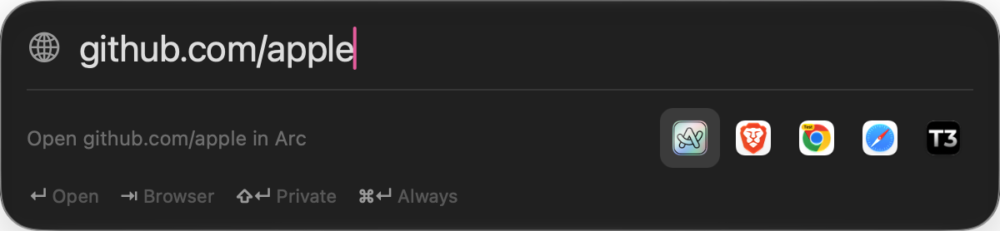

<div align="center">

# ✈︎ Air Traffic

**Every link, cleared for the right browser.**

A tiny, native macOS app that sits where your default browser goes and sends every link
to the right browser, profile or app. Most of the time you never see it.




</div>

## Why

You use Chrome for work, Safari for yourself, and Zoom links should just open Zoom. macOS lets you
pick one default browser. Air Traffic gives you all of them, routed by rules you set once, with no
cloud, no account, no tracking and no Electron.

- **Invisible when it can be.** A rule matches → the link opens. No window, no click.
- **One keystroke when it can't.** A compact picker appears at your cursor. `↵` repeats what you
  picked last time for that site.
- **Tiny and fast.** Native Swift/AppKit, zero dependencies, under 1 MB, always running in the
  background, so no launch delay on a click.
- **Private by design.** No network access, no analytics. Your rules are a plain JSON file.

## Features

| | |
|---|---|
| **Rules** | Route by domain (`figma.com`, subdomains included), domain + path (`github.com/acme`), and/or the app the link came from (Slack, Mail…). |
| **Picker** | Appears at the cursor when no rule matches. Shows each browser *and each profile*, with a colored badge per profile. |
| **Launcher** | Press `⌃⌥Space` anywhere, then type or paste a link (it prefills from the clipboard). Anything that isn't a link becomes a search. |
| **Profiles** | Chrome, Brave, Edge, Vivaldi, Chromium (incl. beta/dev/canary) and Firefox/Zen profiles. |
| **Private windows** | `⇧` + pick, or `"private": true` in a rule. |
| **Clean links** | Strips `utm_*` plus 26 click and tracking IDs (`fbclid`, `gclid`, `msclkid`…). Unwraps Outlook SafeLinks, Google, Facebook, Instagram, YouTube and LinkedIn redirects. |
| **Desktop apps** | Zoom, Teams, Figma, Spotify, Notion and Linear links open in their apps when installed. |
| **Learns** | `⌘` + pick saves a rule for that site. The picker preselects your last choice per site. |

<p align="center"></p>

## Keyboard

| Picker | | Launcher (`⌃⌥Space`) | |
|---|---|---|---|
| `1`–`9`, `↵` | Open | `↵` | Open |
| `←` `→` `⇥` | Move | `⇥` / `⇧⇥` | Next / previous browser |
| `⇧` + open | Private window | `⌘1`–`⌘9` | Open in browser *n* |
| `⌘` + open | Always open this site here | `⇧↵` / `⌘↵` | Private / always |
| `⌘C` | Copy link | `esc` | Close |

Hold `⌥` while clicking any link to get the picker even when a rule matches.

## Install

Requires **macOS 26 Tahoe** or later, on Apple silicon or Intel.

**Download:** grab `Air Traffic.zip` from [Releases](../../releases), move the app to `/Applications`,
open it and click **Make Default**.

**Build from source:**

```sh
git clone <this repo> && cd air-traffic
./build.sh install    # builds a universal app, copies it to /Applications, launches it
```

On macOS 27, allow Air Traffic in **System Settings → Privacy & Security → Files & Folders** to see
browser profiles. The app shows a button for this when it's needed.

## Configuration

Settings covers the common things. Everything else lives in `~/.config/air-traffic/config.json`,
which syncs well with your dotfiles. Hand edits apply to the next link, with no restart.

```jsonc
{
  "rules": [
    // Domain (and its subdomains) → browser profile
    { "match": "figma.com", "app": "com.google.Chrome", "profile": "Profile 1" },
    // Domain + path, only for links clicked in Slack
    { "match": "github.com/acme", "from": "com.tinyspeck.slackmacgap", "app": "com.brave.Browser" },
    // Always private
    { "match": "bank.example", "app": "org.mozilla.firefox", "private": true }
  ],
  "fallback": { "app": "com.apple.Safari" },  // omit to show the picker instead
  "hide": ["com.example.NotABrowser"],         // bundle ids to leave out of the picker
  "cleanURLs": true,
  "openInApps": true,
  "hotkey": "ctrl+opt+space",                 // cmd/opt/ctrl/shift + a–z, 0–9 or space
  "search": "https://duckduckgo.com/?q=%s",
  "menuBarIcon": false
}
```

The real file is plain JSON, so leave out the comments. Rules are checked top to bottom, and the
first match wins. `profile` is the Chromium profile **folder** (`Default`, `Profile 1`) or the Firefox
profile path. Using ⌘ + pick in the picker writes these for you.

Order of decisions for every link: **clean it → your rules → desktop app → fallback → picker.**

## How it compares

| | Air Traffic | Velja | Finicky | Browserosaurus |
|---|:-:|:-:|:-:|:-:|
| Price | Free, open source | $10 | Free, open source | Free, open source (archived) |
| Picker | ✓ | ✓ | – | ✓ |
| Rules (domain, path, source app) | ✓ GUI + JSON | ✓ GUI | ✓ JavaScript | – |
| Browser profiles | ✓ | ✓ | ✓ | – |
| Type/paste launcher | ✓ | – | – | – |
| Tracker cleanup and redirect unwrapping | ✓ | ✓ | via scripts | – |
| Native | ✓ AppKit | ✓ | ✓ | Electron |

Velja is excellent and does more, including Shortcuts actions, browser extensions and JavaScript
URL transforms. Air Traffic aims to be smaller and simpler, and to stay free.

## Privacy

Air Traffic makes **no network requests**. It reads your browsers' profile lists from disk, and it
writes one config file plus a small "last pick per site" list in its preferences. That's all.

## Limitations

- Links clicked *inside* a browser stay in that browser.
- Apps that use Universal Links (some open their own links directly) bypass every default browser.
- Safari profiles, Arc spaces and Dia profiles can't be targeted from outside those browsers.
  For Arc, use its built-in *Air Traffic Control* feature.

## Architecture

```
Sources/AirTrafficCore   Pure Foundation, unit-tested. No UI.
  Router.swift           route(url) → .open(url, target) | .pick(url)   ← the hot path
  Links.swift            tracker stripping, redirect unwrapping, desktop-app mapping, typed input
  Config.swift           Config / Rule / Target (JSON)
Sources/AirTraffic       Thin AppKit shell: background agent, no Dock icon
  AppDelegate.swift      receives links (+ source app, ⌥ key) and wires everything up
  Picker.swift           one pre-built NSPanel + NSGlassEffectView for picker and launcher
  Browsers.swift         discovery, profiles (Chromium Local State, Firefox profiles), launching
  Store.swift            the config file and discovered browsers
  HotKey.swift           global shortcut via Carbon, with no permissions needed
  SettingsView.swift     SwiftUI settings, never on the hot path
```

Design rules: nothing slow on the hot path (no SwiftUI, no network, no disk beyond one `stat`), no
dependencies, and the app stays under 1 MB.

## Contributing

Issues and pull requests are welcome. See [CONTRIBUTING.md](CONTRIBUTING.md). Run `swift test`
before sending a change, and please include a screenshot for any UI change.

## License

[MIT](LICENSE)
